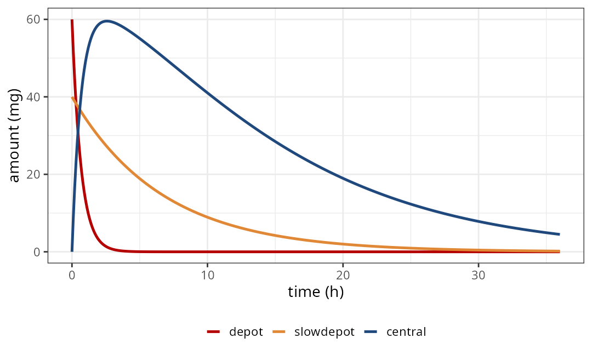
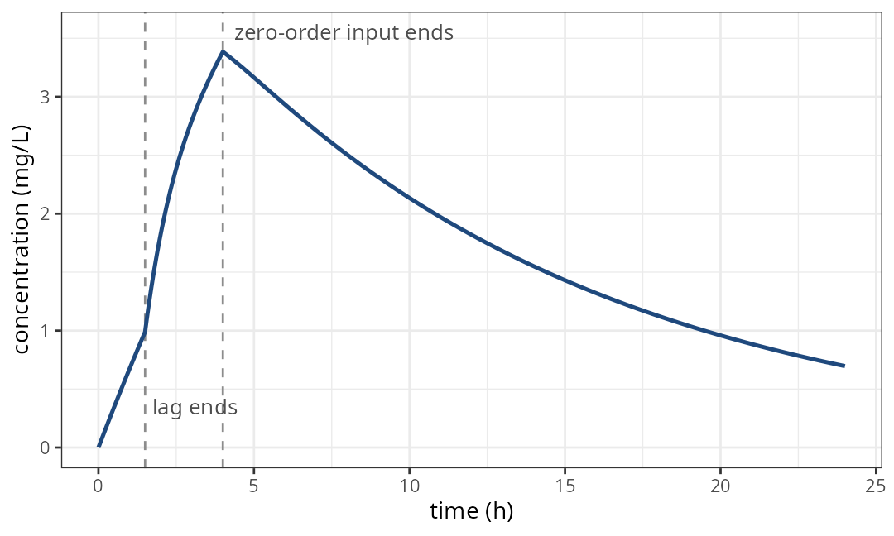
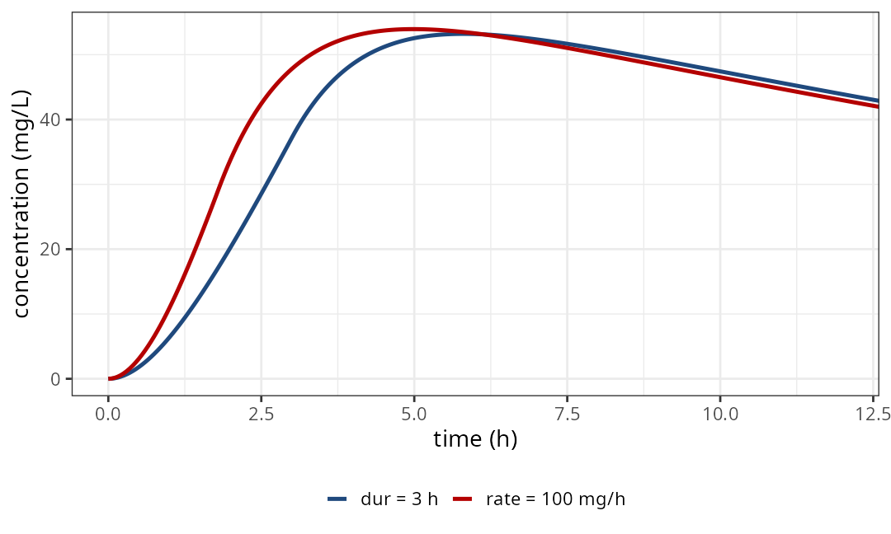
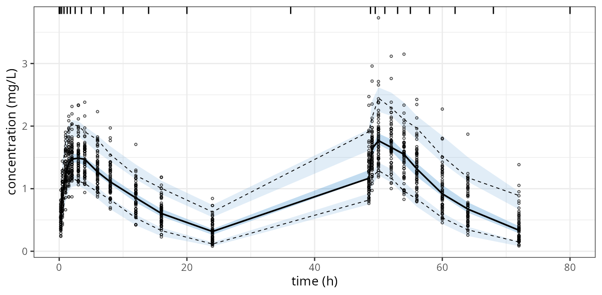
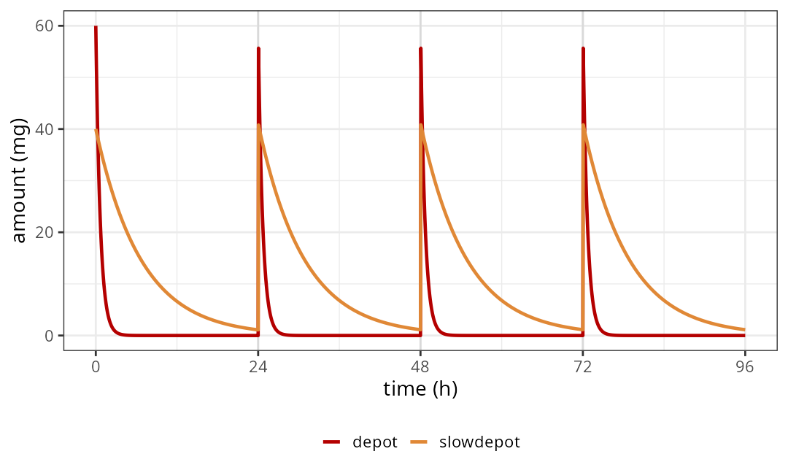

## This talk, in four pictures

::: figgrid
<figure>

<figcaption><b>1.</b> One dose often reaches the blood by two routes</figcaption>
</figure>
<figure>

<figcaption><b>2.</b> A directive in the model splits the dose, not the data</figcaption>
</figure>
<figure>

<figcaption><b>3.</b> Simulating fast, slow and zero-order routes</figcaption>
</figure>
<figure>

<figcaption><b>4.</b> Estimating them</figcaption>
</figure>
:::

::: {.notes}
There are four parts to this talk.

First, the problem: one dose that reaches the blood by two routes.

Second, the new directives that split the dose inside the model.

Third, simulating with them.

And fourth, fitting the same model.
:::

## 1. One dose often reaches the blood by two routes {.sectionbreak}

{.nostretch fig-alt="Illustration: Matt holds a large tablet whose stream of particles winds into a reservoir"}

::: {.notes}
So let's start with the problem.
:::

## Many drugs absorb by a fast route and a slow route at the same time

```{=html}
<svg class="dg" viewBox="0 0 1000 460" role="img"
     aria-label="One 100 mg dose splits: 60 percent goes to depot, which absorbs quickly with ka1, and 40 percent goes to slowdepot, which absorbs slowly with ka2. Both feed the central compartment, which is cleared by CL.">
  <defs>
    <marker id="a1" viewBox="0 0 10 10" refX="9" refY="5" markerWidth="8" markerHeight="8" orient="auto-start-reverse">
      <path d="M0,0 L10,5 L0,10 z" fill="#1f497d"/>
    </marker>
    <marker id="a1r" viewBox="0 0 10 10" refX="9" refY="5" markerWidth="8" markerHeight="8" orient="auto-start-reverse">
      <path d="M0,0 L10,5 L0,10 z" fill="#b40000"/>
    </marker>
    <marker id="a1o" viewBox="0 0 10 10" refX="9" refY="5" markerWidth="8" markerHeight="8" orient="auto-start-reverse">
      <path d="M0,0 L10,5 L0,10 z" fill="#e08836"/>
    </marker>
  </defs>
  <rect x="20" y="180" width="170" height="100" rx="50" fill="#f6efe0" stroke="#1f497d" stroke-width="2"/>
  <text class="big blue" x="105" y="223" text-anchor="middle">one dose</text>
  <text class="t" x="105" y="253" text-anchor="middle">100 mg</text>

  <path d="M190,215 C260,215 270,110 345,110" fill="none" stroke="#b40000" stroke-width="3" marker-end="url(#a1r)"/>
  <path d="M190,245 C260,245 270,350 345,350" fill="none" stroke="#e08836" stroke-width="3" marker-end="url(#a1o)"/>
  <text class="lab red" x="235" y="135">60%</text>
  <text class="lab" x="235" y="340" style="fill:#c0661e">40%</text>

  <rect x="350" y="60" width="220" height="100" rx="8" fill="#fbeaea" stroke="#b40000" stroke-width="2"/>
  <text class="big red" x="460" y="103" text-anchor="middle">depot</text>
  <text class="t" x="460" y="135" text-anchor="middle">fast: ka1 = 1.5 /h</text>
  <rect x="350" y="300" width="220" height="100" rx="8" fill="#fdf1e4" stroke="#e08836" stroke-width="2"/>
  <text class="big" x="460" y="343" text-anchor="middle" style="fill:#c0661e">slowdepot</text>
  <text class="t" x="460" y="375" text-anchor="middle">slow: ka2 = 0.15 /h</text>

  <path d="M570,110 C640,110 650,215 715,215" fill="none" stroke="#b40000" stroke-width="3" marker-end="url(#a1r)"/>
  <path d="M570,350 C640,350 650,245 715,245" fill="none" stroke="#e08836" stroke-width="3" marker-end="url(#a1o)"/>

  <rect x="720" y="180" width="170" height="100" rx="8" fill="#eef3f9" stroke="#1f497d" stroke-width="2"/>
  <text class="big blue" x="805" y="237" text-anchor="middle">central</text>
  <line x1="890" y1="230" x2="975" y2="230" stroke="#1f497d" stroke-width="3" marker-end="url(#a1)"/>
  <text class="t" x="932" y="215" text-anchor="middle">CL</text>
</svg>
```

::: {.notes}
Many oral drugs don't absorb along one neat first order path. Some of
the dose absorbs quickly, and the rest absorbs much more slowly. A
modified release tablet is a good example.

The model for that is easy to write: two depots, each with its own
absorption rate, both feeding the central compartment.

The awkward part has always been the dose. One dose has to end up in
two compartments.
:::

## The usual fix duplicates the dose record, so the data no longer says what was given

```{=html}
<svg class="dg" viewBox="0 0 1000 460" role="img"
     aria-label="Left, the NONMEM approach: the data has two dose rows of 100 mg for one 100 mg tablet, one to compartment 1 and one to compartment 2, and the model sets F1 to FR and F2 to one minus FR. Right, the new approach: the data has one dose row to depot, and the model holds a splitBolus directive.">
  <text class="big red" x="245" y="40" text-anchor="middle">duplicated records</text>
  <rect x="40" y="65" width="410" height="44" fill="#1f497d"/>
  <g class="lab wht"><text x="80" y="94" class="lab wht">ID</text><text x="170" y="94" class="lab wht">TIME</text><text x="275" y="94" class="lab wht">AMT</text><text x="375" y="94" class="lab wht">CMT</text></g>
  <rect x="40" y="109" width="410" height="44" fill="#ffffff" stroke="#c8d3e0"/>
  <rect x="40" y="153" width="410" height="44" fill="#fbeaea" stroke="#c8d3e0"/>
  <g class="t"><text x="80" y="138">1</text><text x="170" y="138">0</text><text x="275" y="138">100</text><text x="375" y="138">1</text>
  <text x="80" y="182">1</text><text x="170" y="182">0</text><text x="275" y="182">100</text><text x="375" y="182">2</text></g>
  <text class="mono" x="40" y="250">F1 = FR</text>
  <text class="mono" x="40" y="280">F2 = 1 - FR</text>
  <text class="t red" x="40" y="340">one 100 mg tablet, 200 mg of dose rows</text>
  <text class="t" x="40" y="372">change the absorption model,</text>
  <text class="t" x="40" y="400">and you rebuild the data</text>

  <line x1="500" y1="40" x2="500" y2="420" stroke="#c8d3e0" stroke-width="2" stroke-dasharray="6 6"/>

  <text class="big grn" x="755" y="40" text-anchor="middle">one record, split in the model</text>
  <rect x="550" y="65" width="410" height="44" fill="#1f497d"/>
  <g><text x="590" y="94" class="lab wht">ID</text><text x="680" y="94" class="lab wht">TIME</text><text x="785" y="94" class="lab wht">AMT</text><text x="875" y="94" class="lab wht">CMT</text></g>
  <rect x="550" y="109" width="410" height="44" fill="#eef6e6" stroke="#c8d3e0"/>
  <g class="t"><text x="590" y="138">1</text><text x="680" y="138">0</text><text x="785" y="138">100</text><text x="875" y="138">depot</text></g>
  <text class="mono" x="550" y="250">splitBolus(depot, depot, slowdepot)</text>
  <text class="mono" x="550" y="280">f(depot)  &lt;- fr</text>
  <text class="mono" x="550" y="310">f(slowdepot) &lt;- 1 - fr</text>
  <text class="t grn" x="550" y="372">the data says what was given;</text>
  <text class="t grn" x="550" y="400">the model says where it goes</text>
</svg>
```

::: {.notes}
In NONMEM, the usual approach is to put the dose in the data twice:
one record for compartment one, and an identical record for compartment
two. The model then sets bioavailability one to the fraction, and bioavailability two to one minus
the fraction.

Unfortunately that means every time you
try a dual absorption model, you might rebuild the data.

Monolix avoids this with its P K macros: two absorption macros share the
same administration, each with its own share.

Now you can do the same thing in the model. The data keeps one row per
dose, and the model decides where that dose goes.
:::

## 2. A directive in the model splits the dose, not the data {.sectionbreak}

{.nostretch fig-alt="Illustration: Matt pulls a switching lever as parcels on a conveyor split onto two tracks, one looping back"}

::: {.notes}
So let's look at how that works.
:::

## One line in the model turns one dose record into a dose for each route

```{=html}
<svg class="dg" viewBox="0 0 1000 440" role="img"
     aria-label="A dose record of 100 mg against depot enters splitBolus(depot, depot, slowdepot). It produces a full 100 mg copy for depot and another for slowdepot. f(depot) of 0.6 scales the first copy to 60 mg and f(slowdepot) of 0.4 scales the second to 40 mg.">
  <defs>
    <marker id="a2" viewBox="0 0 10 10" refX="9" refY="5" markerWidth="8" markerHeight="8" orient="auto-start-reverse">
      <path d="M0,0 L10,5 L0,10 z" fill="#1f497d"/>
    </marker>
  </defs>
  <rect x="10" y="170" width="190" height="90" rx="8" fill="#ffffff" stroke="#1f497d" stroke-width="2"/>
  <text class="lab blue" x="105" y="205" text-anchor="middle">dose record</text>
  <text class="mono" x="105" y="238" text-anchor="middle">100 → depot</text>
  <line x1="200" y1="215" x2="250" y2="215" stroke="#1f497d" stroke-width="3" marker-end="url(#a2)"/>

  <rect x="255" y="160" width="250" height="110" rx="8" fill="#1f497d"/>
  <text class="mono" x="380" y="208" text-anchor="middle" style="fill:#ffffff">splitBolus(depot,</text>
  <text class="mono" x="380" y="235" text-anchor="middle" style="fill:#ffffff">depot, slowdepot)</text>

  <path d="M505,190 C560,190 560,95 610,95" fill="none" stroke="#1f497d" stroke-width="3" marker-end="url(#a2)"/>
  <path d="M505,240 C560,240 560,335 610,335" fill="none" stroke="#1f497d" stroke-width="3" marker-end="url(#a2)"/>

  <rect x="615" y="55" width="130" height="80" rx="8" fill="#ffffff" stroke="#b40000" stroke-width="2"/>
  <text class="big red" x="680" y="100" text-anchor="middle">100</text>
  <text class="sm" x="680" y="124" text-anchor="middle">full copy</text>
  <rect x="615" y="295" width="130" height="80" rx="8" fill="#ffffff" stroke="#e08836" stroke-width="2"/>
  <text class="big" x="680" y="340" text-anchor="middle" style="fill:#c0661e">100</text>
  <text class="sm" x="680" y="364" text-anchor="middle">full copy</text>

  <line x1="745" y1="95" x2="820" y2="95" stroke="#b40000" stroke-width="3" marker-end="url(#a2)"/>
  <text class="mono" x="782" y="80" text-anchor="middle">× 0.6</text>
  <line x1="745" y1="335" x2="820" y2="335" stroke="#e08836" stroke-width="3" marker-end="url(#a2)"/>
  <text class="mono" x="782" y="320" text-anchor="middle">× 0.4</text>

  <rect x="825" y="45" width="160" height="100" rx="8" fill="#fbeaea" stroke="#b40000" stroke-width="2"/>
  <text class="big red" x="905" y="88" text-anchor="middle">depot</text>
  <text class="t" x="905" y="120" text-anchor="middle">60 mg</text>
  <rect x="825" y="285" width="160" height="100" rx="8" fill="#fdf1e4" stroke="#e08836" stroke-width="2"/>
  <text class="big" x="905" y="328" text-anchor="middle" style="fill:#c0661e">slowdepot</text>
  <text class="t" x="905" y="360" text-anchor="middle">40 mg</text>

  <text class="mono" x="560" y="425">f(depot) &lt;- 0.6;  f(slowdepot) &lt;- 0.4</text>
</svg>
```

::: {.notes}
A splitting function goes in the model block. Here, we split the bolus with
depot as the source, and depot and slow depot as the targets.

Every dose recorded against depot is copied, and each target gets the
full amount. So the directive copies the dose; it doesn't divide it.

To divide it, you give each target a share with the f property. Sixty percent stays
in depot for the fast route, and forty percent goes to the slow depot for
the slow one.

Notice that the source, depot, is also one of the targets. That's
usually what you want: the data says depot, and depot is still one of
the absorption routes.
:::

## Four functions cover boluses, infusions, and a mix of the two

::: bigtable
| directive | a bolus record becomes | an infusion record becomes |
|---|---|---|
| `splitBolus(src, ...)` | a bolus in each target | not split |
| `splitInfusion(src, ...)` | not split | an infusion in each target |
| `splitInfusionBolus(src, ...)` | an infusion in the **first** target, a bolus in the rest | an infusion in each target |
| `splitBolusInfusion(src, ...)` | a bolus in each target except the **last**, which gets an infusion | an infusion in each target |
:::

::: {.smallnote}
One function per model. A dose type the function doesn't split goes to the source unchanged.
:::

::: {.notes}
There are four of these functions.

Split bolus, Split infusion do what their name implies.

The two mixed ones split both kinds. And they can also turn a plain
bolus into a modeled infusion for one target: the first target for
split infusion bolus, or the last target for split bolus infusion. That
gives you a zero order and a first order input from one oral dose.

You can use one split function per model. And a dose type that the
directive doesn't split goes to the source compartment unchanged.
:::

## The same directive splits, copies, or moves a dose, depending on the targets and f()

```{=html}
<svg class="dg" viewBox="0 0 1000 470" role="img"
     aria-label="Four cases. Three targets with f shares of 0.5, 0.3 and 0.2 give 50, 30 and 20 mg. The same three targets without f give 100 mg each. One target moves the whole dose: splitBolus(depot, slowdepot) leaves depot at zero and puts 100 mg in slowdepot. A source that is not a target is only a label: splitInfusion(sc, fast, slow) with d/dt(sc) of zero.">
  <g>
    <rect x="10" y="10" width="480" height="210" rx="10" fill="#f6f9fc" stroke="#c8d3e0" stroke-width="2"/>
    <text class="lab blue" x="30" y="45">more than two routes, shared by f()</text>
    <text class="mono" x="30" y="80">splitBolus(depot, depot, mid, slowdepot)</text>
    <text class="mono" x="30" y="108">f() = 0.5, 0.3, 0.2</text>
    <rect x="30" y="135" width="215" height="50" fill="#b40000"/><text class="lab wht" x="137" y="167" text-anchor="middle">50</text>
    <rect x="245" y="135" width="129" height="50" fill="#e08836"/><text class="lab wht" x="309" y="167" text-anchor="middle">30</text>
    <rect x="374" y="135" width="86" height="50" fill="#9bbb59"/><text class="lab wht" x="417" y="167" text-anchor="middle">20</text>
  </g>
  <g>
    <rect x="510" y="10" width="480" height="210" rx="10" fill="#f6f9fc" stroke="#c8d3e0" stroke-width="2"/>
    <text class="lab blue" x="530" y="45">no f(): every target gets it all</text>
    <text class="mono" x="530" y="80">splitBolus(depot, depot, mid, slowdepot)</text>
    <text class="mono" x="530" y="108">no f()</text>
    <rect x="530" y="135" width="140" height="50" fill="#b40000"/><text class="lab wht" x="600" y="167" text-anchor="middle">100</text>
    <rect x="675" y="135" width="140" height="50" fill="#e08836"/><text class="lab wht" x="745" y="167" text-anchor="middle">100</text>
    <rect x="820" y="135" width="140" height="50" fill="#9bbb59"/><text class="lab wht" x="890" y="167" text-anchor="middle">100</text>
  </g>
  <g>
    <rect x="10" y="240" width="480" height="210" rx="10" fill="#f6f9fc" stroke="#c8d3e0" stroke-width="2"/>
    <text class="lab blue" x="30" y="275">one target moves the dose</text>
    <text class="mono" x="30" y="310">splitBolus(depot, slowdepot)</text>
    <text class="mono" x="30" y="338">splitInfusion(depot, slowdepot)</text>
    <rect x="30" y="365" width="140" height="50" fill="#ffffff" stroke="#b40000" stroke-width="2" stroke-dasharray="6 5"/><text class="lab red" x="100" y="397" text-anchor="middle">depot 0</text>
    <rect x="200" y="365" width="200" height="50" fill="#e08836"/><text class="lab wht" x="300" y="397" text-anchor="middle">slowdepot 100</text>
  </g>
  <g>
    <rect x="510" y="240" width="480" height="210" rx="10" fill="#f6f9fc" stroke="#c8d3e0" stroke-width="2"/>
    <text class="lab blue" x="530" y="275">source not a target: only a label</text>
    <text class="mono" x="530" y="310">splitInfusion(sc, fast, slow)</text>
    <text class="mono" x="530" y="338">d/dt(sc) &lt;- 0</text>
    <text class="t" x="530" y="390">the data says sc; the dose goes</text>
    <text class="t" x="530" y="418">only to fast and slow</text>
  </g>
</svg>
```

::: {.notes}
The same rules give you a few useful variations.

You can split into as many compartments as you need. With three
targets and f property shares of a half, three tenths and two tenths, one record
becomes fifty, thirty and twenty milligrams.

Without the f property, every target gets the whole dose. That's why
the f property is how you divide it.

With one target, the directive moves the dose instead of splitting it.
Split bolus from depot to slow depot sends every bolus to the slow depot, and
depot gets nothing. Split infusion does the same for infusions. That's
handy when the data says depot, but the model wants the dose somewhere
else.

And if the source isn't one of the targets, it's only a label for the
data. It still needs an equation, but a derivative of zero is enough.
:::

## 3. Simulating fast, slow and zero-order routes {.sectionbreak}

{.nostretch fig-alt="Illustration: Matt stands beside a double hourglass fed from one funnel, both chambers emptying into one basin"}

::: {.notes}
Now let's simulate with these directives.
:::

## One 100 mg record splits 60/40 and gives the same answer as duplicated records

:::: columns
::: {.column width="62%"}
{.plot .nostretch fig-alt="Amounts over 36 hours: depot starts at 60 mg and empties within a few hours, slowdepot starts at 40 mg and empties slowly, central rises to about 60 mg near 2.5 hours and declines"}
:::
::: {.column width="38%" .codemid}
```r
ev <- et(amt = 100,
         cmt = "depot") |>
  et(seq(0, 36, by = 0.1))

rxSolve(dual |> zeroRe(), ev)
```

Same `cp` as two dose records with `F1`/`F2`:

```r
all.equal(...)
#> [1] TRUE
```
:::
::::

::: {.notes}
Here is the fast and slow model with one hundred milligrams, recorded
once against depot.

Depot starts at sixty milligrams and empties within a few hours. The slow
depot starts at forty milligrams, and it's still emptying a day later.

To check it, I solved the old way too, with the dose entered twice and
no directive. The concentrations are the same.
:::

## splitInfusionBolus() gives a zero-order and a first-order input from one oral dose

:::: columns
::: {.column width="42%" .codemid}
```r
splitInfusionBolus(depot,
                   central, depot)
dur(central)  <- tk0  # 4 h
f(central)    <- fr   # 0.7
f(depot)      <- 1 - fr
alag(depot)   <- lag2 # 1.5 h

d/dt(depot)   <- -ka2 * depot
d/dt(central) <-  ka2 * depot -
                  cl / v * central
```
:::
::: {.column width="58%"}
{.plot .nostretch fig-alt="Concentration over 24 hours: a straight rise until the lag ends at 1.5 hours, a steeper rise until the zero-order input ends at 4 hours, then a decline"}
:::
::::

::: {.notes}
The second common shape is a zero order input straight into central,
plus first order absorption from the depot.

The dose record is still a plain oral bolus. Split infusion bolus turns
it into a modeled infusion for the first target, central, and a bolus
for the others. Central declares its duration, four hours, and gets
seventy percent. The depot gets the other thirty percent, after a lag
of an hour and a half.

You can see the shape change when the lag ends, and again when the zero
order input stops.
:::

## Only the first or last target becomes the infusion; every other target gets a bolus

```{=html}
<svg class="dg" viewBox="0 0 1000 300" role="img"
     aria-label="splitInfusionBolus(src, A, B, C) makes A, the first target, an infusion, and B and C boluses. splitBolusInfusion(src, A, B, C) makes C, the last target, the infusion, and A and B boluses.">
  <text class="mono" x="20" y="72">splitInfusionBolus(src, A, B, C)</text>
  <text class="sm" x="20" y="100">first target is the infusion</text>
  <g>
    <rect x="460" y="40" width="150" height="64" rx="8" fill="#1f497d"/><text class="lab wht" x="535" y="79" text-anchor="middle">A infusion</text>
    <rect x="630" y="40" width="150" height="64" rx="8" fill="#ffffff" stroke="#1f497d" stroke-width="2"/><text class="lab blue" x="705" y="79" text-anchor="middle">B bolus</text>
    <rect x="800" y="40" width="150" height="64" rx="8" fill="#ffffff" stroke="#1f497d" stroke-width="2"/><text class="lab blue" x="875" y="79" text-anchor="middle">C bolus</text>
  </g>
  <line x1="20" y1="150" x2="980" y2="150" stroke="#c8d3e0" stroke-width="2" stroke-dasharray="6 6"/>
  <text class="mono" x="20" y="232">splitBolusInfusion(src, A, B, C)</text>
  <text class="sm" x="20" y="260">last target is the infusion</text>
  <g>
    <rect x="460" y="200" width="150" height="64" rx="8" fill="#ffffff" stroke="#1f497d" stroke-width="2"/><text class="lab blue" x="535" y="239" text-anchor="middle">A bolus</text>
    <rect x="630" y="200" width="150" height="64" rx="8" fill="#ffffff" stroke="#1f497d" stroke-width="2"/><text class="lab blue" x="705" y="239" text-anchor="middle">B bolus</text>
    <rect x="800" y="200" width="150" height="64" rx="8" fill="#1f497d"/><text class="lab wht" x="875" y="239" text-anchor="middle">C infusion</text>
  </g>
</svg>
```

::: {.notes}
Both mixed directives take any number of targets, but only one becomes
an infusion, and its position is fixed. It's the first target for
split infusion bolus, and the last target for split bolus infusion.
Every other target gets a bolus.

:::

## With f(), a fixed rate shortens each infusion; a fixed duration lowers its rate

:::: columns
::: {.column width="60%"}
{.plot .nostretch fig-alt="Concentration over 12 hours for the same 300 mg over 3 hours, split 60/40: the rate record rises faster than the duration record, and the two converge after about 6 hours"}
:::
::: {.column width="40%" .codemid}
```r
splitInfusion(sc, fast, slow)
f(fast) <- 0.6
f(slow) <- 0.4
```

300 mg written two ways:

- `rate = 100`: copies run **1.8 h** and **1.2 h** at 100 mg/h
- `dur = 3`: copies run **3 h** at **60** and **40 mg/h**
:::
::::

::: {.notes}
Split infusion handles infusions that are already in the data.

Remember that the f property scales the amount. When you scale an infusion, the solver
follows NONMEM: it holds fixed whichever of rate or duration the record
gives.

So the same three hundred milligrams over three hours gives two
different profiles. With a fixed rate, each copy runs at a hundred
milligrams an hour, for a shorter time. With a fixed duration, each
copy runs for three hours, at a lower rate.

Neither is wrong, but you need to know which one your data means.
:::

## 4. Estimating them {.sectionbreak}

{.nostretch fig-alt="Illustration: Matt measures two streams rising from an open ledger with a brass caliper, gauges beside him"}

::: {.notes}
Finally, let's fit these models.
:::

## The fitting data keeps one row per dose and never mentions slowdepot

::: midtable
| ID | TIME | EVID | AMT | II | ADDL | CMT | DV |
|---|---|---|---|---|---|---|---|
| 1 | 0.00 | 1 | 100 | 24 | 2 | **depot** | . |
| 1 | 0.25 | 0 | 0 | 0 | 0 | cp | 0.563 |
| 1 | 0.50 | 0 | 0 | 0 | 0 | cp | 0.795 |
| 1 | 1.00 | 0 | 0 | 0 | 0 | cp | 1.15 |
:::

::: {.smallnote}
60 simulated subjects, 100 mg daily for 3 days, rich sampling after the first and the last dose.
Build dose rows directly: `addDosing = TRUE` returns the *translated* rows, one for `depot` and one for `slowdepot`.
:::

::: {.notes}
I simulated sixty subjects from the fast and slow model, each taking one
hundred milligrams daily for three days.

The dataset has one dose row, recorded against depot. It never
mentions the slow depot. The absorption model is in the model, and only
there.

One tip: build the dose rows directly. When a model splits its doses,
the add dosing option of the solver returns the translated records, one
for depot and one for the slow depot.
:::

## FOCEi and SAEM both recover the parameters that generated the data

::: bigtable
| parameter | truth | FOCEi | SAEM |
|---|---|---|---|
| fast absorption ka1 (1/h) | 1.5 | 1.51 | 1.49 |
| slow absorption ka2 (1/h) | 0.15 | 0.155 | 0.147 |
| fraction by the fast route | 0.6 | 0.610 | 0.618 |
| clearance CL (L/h) | 4 | 4.14 | 4.13 |
| volume V (L) | 40 | 39.3 | 39.0 |
:::

::: {.smallnote}
Same model function and same data for both: `nlmixr(dual, dat, "focei")` and `nlmixr(dual, dat, "saem")`.
:::

::: {.notes}
Then I fit that data using the same model
function.

Both fits come back close to the values that generated the data. The
fraction absorbed by the fast route is often the hardest parameter to
estimate in a dual absorption model, and both methods land within a few
percent of it.
:::

## The VPC, and every other post-fit tool, applies the same split

{.plot .nostretch fig-alt="Visual predictive check of the SAEM fit over 72 hours: observed percentiles lie within the simulated intervals after the first and the last dose"}

::: {.smallnote}
Simulated from the fit with the original one-row-per-dose data; bins set halfway between the nominal sample times.
:::

::: {.notes}
Everything after the fit uses the same model, so the split keeps
working.

This visual predictive check simulates from the fit with the
original data, and the observed percentiles sit
inside the simulated intervals.

The same goes for individual predictions, and for simulating a new dosing regimen.
:::

## splitBolus() also splits the doses a model adds while it solves

:::: columns
::: {.column width="60%"}
{.plot .nostretch fig-alt="Amounts over 96 hours: after the first dose and after a rescue dose at 24, 48 and 72 hours, depot and slowdepot both jump, by 60 and 40 mg"}
:::
::: {.column width="40%" .codemid}
```r
splitBolus(depot, depot, slowdepot)
...
if (t > 0 && t %% 24 == 0 &&
    cp < 0.5) {
  bolus(100)
}
```

The other three directives split only doses in the data.
:::
::::

::: {.notes}
In an earlier post, I showed how a model can add doses while it solves.
Split bolus applies to those doses too.

Here, every twenty four hours the model checks the trough, and adds a
rescue dose if it's too low. Each rescue dose is split sixty forty,
just like the dose from the data.

The other three directives only split doses in the data. So if an
adaptive model needs to add doses to a split route, use split bolus.
:::

## Put one dose row in the data, and let the model decide where it goes

:::: columns
::: {.column width="55%"}
- One dose row per dose, recorded against a source compartment
- A directive in `model({})` sends it to each target
- `f()` gives each target its share; `alag()`, `dur()` and `rate()` give each route its own timing
- Help pages: `?splitBolus` and `?splitInfusion`

::: rule
:::

::: {style="font-size: 0.6em; line-height: 1.3;"}
Works with the current CRAN releases, rxode2 5.1.8 and nlmixr2est 7.2.1. The silent-bolus cases are tracked in github
:::
:::

::: {.column width="45%" .checks}
- The data says what was given
- One model for simulation and for every estimation method
- Change the absorption model without rebuilding the data
:::
::::

::: {.notes}
So, to sum up. Put one dose row per dose in the data. Add a splitting
directive to the model to say where that dose goes. Use the f property to give each
target its share, and the lag, duration and rate properties to give
each route its own timing.

The same model simulates and fits, with every
estimation method, and you can change the absorption model without
touching the data.

All of this works with the current CRAN releases.
:::

## Thank you {.thanks}

::: {.credit}
Section illustrations are Gemini-generated artwork, drawn from a photo of Matthew Fidler
:::

::: {.notes}
Thank you.
:::
